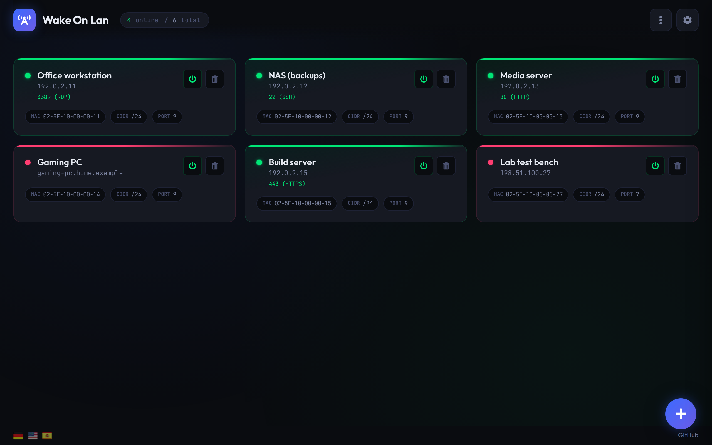
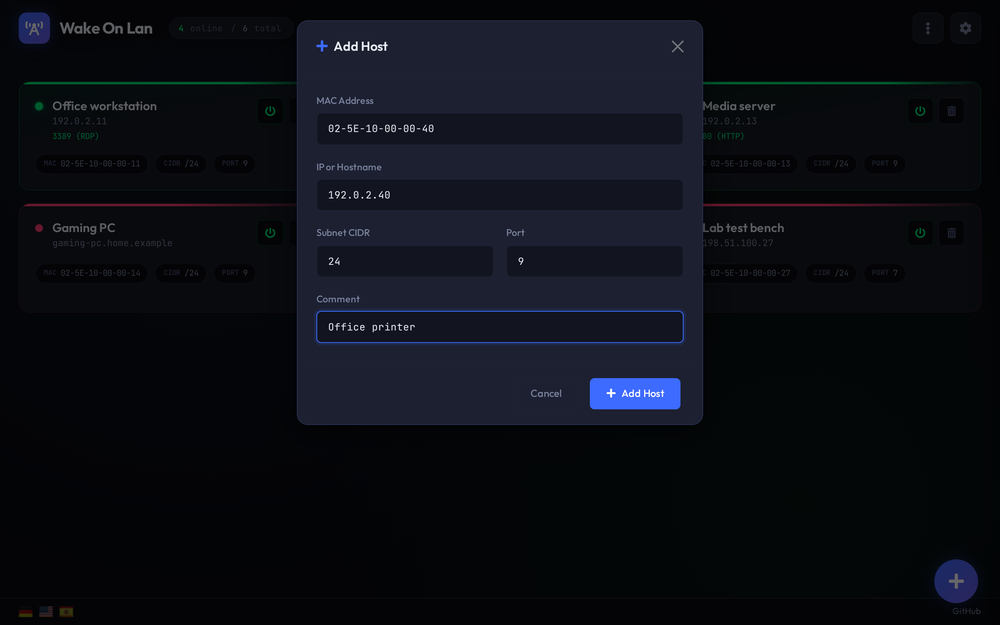
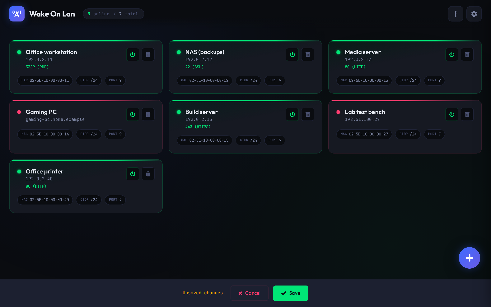
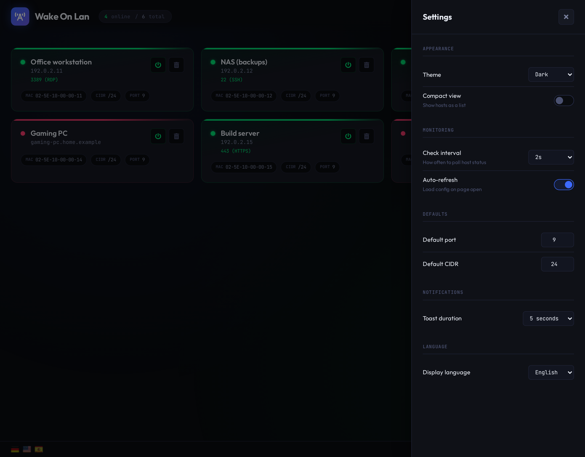
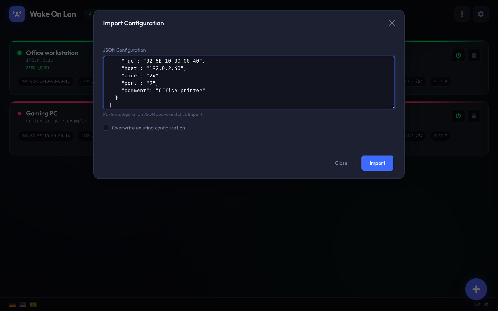

# wake-on-lan_plus

A web page for sending Wake-on-LAN magic packets to the computers on your network,
with a live online/offline status for each host. PHP, a single page, no database: the
hosts are kept in a `config.json` (in Docker: in `/data`, outside the web root). Runs in
Docker or on any PHP web server.



**Status:** maintained; CI publishes the image on GHCR for `linux/amd64` and `linux/arm64` (see [Image](#image)).

Forked from [AndiSHFR/wake-on-lan.php](https://github.com/andishfr/wake-on-lan.php), maintained by [phoen-ix](https://github.com/phoen-ix/wake-on-lan_plus).
This is a security-hardened, modular rewrite of the 2024 release.

**Every screen: [the screenshot gallery](docs/screenshots/README.md).** The host grid
[in the light theme](docs/screenshots/hosts-grid.light.png) and [on a phone](docs/screenshots/hosts-grid.mobile.png).

**Contents:** [Quick Start](#quick-start-docker-compose) · [Features](#features) · [Bare Metal](#requirements-bare-metal) · [Usage](#usage) · [Configuration Format](#configuration-format) · [Languages](#internationalization) · [Project Structure](#project-structure) · [Screenshots](#screenshots) · [E2E tests](#e2e-tests) · [License](#license)

## Quick Start (Docker Compose)

A magic packet is a broadcast, so the container has to sit on your LAN. That is why
`docker-compose.yml` puts it on a macvlan network with its own LAN address.

1. Clone the repository
2. (Optional) Copy `example.env` to `.env` and adjust values
3. Create a macvlan network matching your LAN:

```bash
docker network create -d macvlan \
  --subnet=192.168.1.0/24 \
  --gateway=192.168.1.1 \
  -o parent=eth0 macvlan_network
```

4. Update the `ipv4_address` in `docker-compose.yml` to a free IP on your network
5. Start the container:

```bash
docker compose up -d
```

6. Open `http://<ipv4_address>/` from another device on the LAN.
   - On a macvlan network the `ports:` mapping (`HOST_PORT`) does not apply.
   - The Docker host itself cannot reach its own macvlan containers.

`docker-compose.yml` runs the image's own app code and mounts `./volume/config/` at
`/data`. That is where `config.json` and `config_backups/` end up, outside the web root.

### Upgrading from a compose file that mounts the web root

Older versions of `docker-compose.yml` mounted `./volume/config/` over the web root
(`/var/www/html/`) and the app code from the checkout on top. To switch to the current
layout:

1. Update the checkout and keep your `ipv4_address` edit:
   - with git: `git stash && git pull && git stash pop`
   - without git: replace the `volumes:` block by hand
   - either way, `volumes:` must then hold only `- ./volume/config/:/data`: the new
     image reads, writes and backs up the config only in `/data`.
2. `docker compose pull && docker compose up -d`. The same `./volume/config/` is now
   mounted at `/data`, so your hosts and backups stay where they are.
3. Docker may have left empty `index.php`, `includes/` and `assets/` mount points in
   `volume/config/`. They are unused; delete them (they belong to root:
   `sudo rm -r volume/config/index.php volume/config/includes volume/config/assets`).
4. With your own compose file or `docker run`: mount the directory that holds
   `config.json` at `/data` instead of `/var/www/html/`, and drop any bind mounts of the
   app code.

### Image

`docker-compose.yml` pulls `ghcr.io/phoen-ix/wake-on-lan_plus` (GitHub Container Registry), for `linux/amd64` and `linux/arm64`.
CI publishes it after the tests pass:

| Tag | Source |
|---|---|
| `latest` | current `master` |
| `sha-<short>` | a specific `master` commit |
| `X.Y.Z` | release tag `vX.Y.Z` |

Pick a tag with `WAKE_ON_LAN_PLUS_IMAGE` in `.env` (default `latest`). To update:
`docker compose pull && docker compose up -d` (and `git pull` for changes to
`docker-compose.yml`).

> The old Docker Hub image `phoen9/wake-on-lan_plus` (last pushed February 2024, before this rewrite) is no longer updated.
> If your compose file still says `image: phoen9/wake-on-lan_plus`, switch it to `ghcr.io/phoen-ix/wake-on-lan_plus`.

To build the image yourself instead: `docker build -t wake-on-lan_plus .` and set `image: wake-on-lan_plus` in `docker-compose.yml`.

### Optional: Enable Authentication

> ⚠️ Authentication is off by default, also in the shipped `docker-compose.yml`. Without it,
> anyone who can reach the page can read and change the host list and wake hosts.

Set credentials in your `.env` file or directly in `docker-compose.yml`:

```env
WOL_USERNAME=admin
WOL_PASSWORD=your_secure_password
```

Leave both empty to disable authentication.

### Optional: Configure Rate Limits

The limits count requests per client IP address (behind a reverse proxy, every client
shares the proxy's address). Set them in `.env`;
`docker-compose.yml` passes them through, and empty means the default:

```env
WOL_RATE_LIMIT_CONFIG_SET=10       # Max config saves per window (default: 10)
WOL_RATE_LIMIT_HOST_CHECK=120      # Max host checks per window (default: 120)
WOL_RATE_LIMIT_HOST_WAKEUP=5       # Max wake-up requests per window (default: 5)
WOL_RATE_LIMIT_WINDOW_SECS=60      # Rate limit window in seconds (default: 60)
```

The page checks one host per tick of the check interval: at 1s, up to 60 checks a minute
per open page (every page from one IP address counts against the same limit). The
default of 120 covers two such pages. Checks over the limit fail, and those hosts show as offline.

---

## Features

  * **Host cards** in a responsive grid, with a pulsing green dot for online hosts, red
    for offline and amber while a check runs. The header shows "X online / Y total".
  * **Status checks** on ports 3389 (RDP), 22 (SSH), 80 (HTTP), 443 (HTTPS) and 5938
    (TeamViewer). The card shows the first port that answers.
  * **Add Host dialog** behind the floating **+** button. It validates MAC, CIDR and port,
    and pre-fills CIDR and port from Settings.
  * **Drag-and-drop reordering** of the cards (jQuery UI sortable).
  * **Floating save bar** while there are unsaved changes.
  * **Themes:** Dark (default), Light and Auto. Plus a compact list view.
  * **Settings panel**, stored per browser in `localStorage`.
  * **Toast notifications**, announced to screen readers. The icon buttons and settings
    controls have accessible names.
  * **Import/export** of the configuration as JSON, and a download of the saved
    `config.json`.
  * **Debug trace:** with `WOL_DEBUG=1` set on the server, open the page with `?debug=1`
    and every wake request returns the step-by-step trace (MAC check, broadcast address,
    socket calls) as `DEBUG` in its JSON response. Without `WOL_DEBUG=1`, `?debug=1` is
    ignored.



### Security

  * **CSRF protection** on all state-changing operations (CONFIG.SET, HOST.WAKEUP) via the `X-CSRF-TOKEN` header.
  * **One CSRF token per session**, so parallel requests (several wakes at once) all pass.
  * **Rate limiting per client IP** and action (a client without a session cookie still counts), configurable via environment variables (see [Configure Rate Limits](#optional-configure-rate-limits)).
  * **Optional HTTP Basic Authentication** via `WOL_USERNAME` and `WOL_PASSWORD`.
  * **SSRF prevention:** HOST.CHECK only checks hosts of the saved configuration (a host added on the page shows offline until it is saved), and the `host` parameter allows letters, digits, dots, hyphens and colons only (at most 253 characters).
  * **Security headers:** `X-Content-Type-Options`, `X-Frame-Options`, `X-XSS-Protection`, `Referrer-Policy`.
  * **Config outside the web root:** the image keeps `config.json` and its backups in `/data` (`WOL_CONFIG_DIR`).
  * **`.htaccess` protections:** they block direct web access to `config.json` (and its temp files and backups, for installs that keep it next to `index.php`), `includes/` and the old monolith file.
  * **Escaped host values:** quotes and HTML in a comment or other host field show as text and never run.
  * **Timing-safe comparisons** via `hash_equals()` for tokens and credentials.
  * **JSON structure validation** on configuration saves and imports.
  * **Atomic config file writes:** a temp file plus `rename()`.
  * **Anchored MAC address validation:** the regex is anchored with `^`/`$`.
  * HOST.WAKEUP is a POST.

### Docker

  * **Image on GHCR:** `ghcr.io/phoen-ix/wake-on-lan_plus`, built by CI for `linux/amd64` and `linux/arm64` after the tests pass.
  * Built on the official PHP Apache image (the tag is pinned in [`Dockerfile`](Dockerfile)), with the `sockets` extension.
  * **Production `php.ini`:** PHP warnings go to the log (`docker logs`), never into a response.
  * **HEALTHCHECK:** checks every 30 seconds that Apache responds.
  * **Config backup:** on every container start, the entrypoint copies `config.json` to `/data/config_backups/` and keeps the last 5 copies.

---

## Requirements (Bare Metal)

  * PHP 8.x with the `sockets` and `mbstring` extensions enabled
  * Apache with `AllowOverride All` (for the `.htaccess` protections)
  * Internet connection for CDN includes (Bootstrap, jQuery, jQuery UI, Font Awesome, Google Fonts)
  * Web server must be allowed to write to `config.json`

## Installation (Bare Metal)

1. Clone the repository or download the zip file
2. Copy the project files to a directory on your web server
3. Ensure the web server can write to the directory (for `config.json`). Or keep the
   file outside the web root: point the environment variable `WOL_CONFIG_DIR` at a
   writable directory (for example `SetEnv WOL_CONFIG_DIR /var/lib/wake-on-lan` with
   mod_php)
4. Navigate to the `index.php` URL in your browser

### Enabling the PHP Sockets Extension

  * Open your `php.ini` file
  * Find the line `;extension=sockets`
  * Remove the leading semicolon (`;`) to enable it
  * Reload your web server

---

## Usage

### Adding a Host
Click the **+** floating action button (bottom-right corner) to open the Add Host modal.

  * **MAC Address:** `-` or `:` separators, or the raw 12 hex digits (dashes are then added).
  * **IP or Hostname:** required. It is used for the status checks and for the broadcast address.
  * **CIDR:** the subnet size. The default comes from Settings (initially 24).
  * **Port:** the UDP port for the magic packet. The default comes from Settings (initially 9).
  * **Comment:** optional. It is shown as the card title.

### Waking a Host
Click the power icon button on any host card to send a magic packet.

### Removing a Host
Click the trash icon on a host card. Its data goes into the Add Host form fields, so you can re-add it.

### Saving
Adding, removing, reordering and importing only change the page. Click the green **Save** button
in the floating save bar (it appears at the bottom when there are changes), or use _Options_ >
_Save Configuration_. **Cancel** reloads the page.



### Host Status
The page checks the hosts one at a time, one per tick of the check interval. A check tries
ports 3389 (RDP), 22 (SSH), 80 (HTTP), 443 (HTTPS) and 5938 (TeamViewer) in that order, each
with a 3-second timeout. Each card shows a status indicator:
  * **Green pulsing dot:** the host is online. The card shows the port that answered.
  * **Red dot:** the host is offline.
  * **Amber dot:** a check is in progress.

The check interval is configurable in Settings (1s, 2s, 5s, 10s, 30s, or disabled). See
[Configure Rate Limits](#optional-configure-rate-limits) before lowering the default
`WOL_RATE_LIMIT_HOST_CHECK`.

### Settings Panel
Click the gear icon in the header to open the settings sidebar. All settings are saved to `localStorage` and persist across sessions:

| Setting | Description | Default |
|---|---|---|
| Theme | Dark, Light, or Auto (follows system preference) | Dark |
| Compact view | Switches from card grid to single-column list | Off |
| Check interval | How often to poll host status | 2s |
| Auto-refresh | Load configuration from server on page open | On |
| Default port | Pre-filled port for new hosts | 9 |
| Default CIDR | Pre-filled CIDR for new hosts | 24 |
| Toast duration | How long notifications stay visible | 5 seconds |
| Language | Display language (English, Deutsch, Español) | English |



### Options Menu

| Option | Description |
|---|---|
| Download Configuration | Downloads the configuration saved on the server as `wake-on-lan-<date>-<time>.json` |
| Export Configuration | Shows the configuration on the page as JSON, for manual copy |
| Import Configuration | Paste JSON to append hosts, or replace them with **Overwrite existing configuration**. Anything but a list of hosts with `mac` and `host` is refused |
| Load Configuration | Reloads the configuration from the server, replacing or appending to the page's hosts |
| Save Configuration | Saves the page's configuration to the server (only shown while there are unsaved changes) |



### Running Tests

```bash
php tests/test_functions.php
```

The `wakeOnLan()` validation tests need PHP's `sockets` extension, which the Docker image
installs. Without it locally, run them in the image:

```bash
docker build -t wake-on-lan_plus-test .
docker run --rm --entrypoint php -v "$PWD":/app:ro -w /app wake-on-lan_plus-test tests/test_functions.php
```

---

## Configuration Format

Stored as `config.json` in `WOL_CONFIG_DIR` (`/data` in the image; without it, next to
`index.php`), a JSON array of host objects:

```json
[
  {
    "mac": "AA-BB-CC-DD-EE-FF",
    "host": "192.168.1.100",
    "cidr": "24",
    "port": "9",
    "comment": "My Computer"
  }
]
```

---

## Internationalization

Language switching is available via the Settings panel or the flag icons in the footer:
English, German (Deutsch) and Spanish (Español). The selected language is persisted in
`localStorage`. The translations cover the options menu, the Load Configuration question
and the Add Host form labels only; the rest of the page stays in English.

---

## Project Structure

```
index.php                  Main entry point (AJAX routing + HTML UI)
includes/
  auth.php                 Authentication, CSRF token
  functions.php            Core WoL functions & utilities
  .htaccess                Blocks direct web access to includes/
assets/
  app.js                   Client-side JavaScript application
  style.css                CSS styles (dark and light themes)
tests/
  test_functions.php       Unit tests (run: php tests/test_functions.php)
e2e/                       Playwright (own Node package): e2e suite (tests/) + docs tour (docs/)
scripts/e2e.sh             Builds the image, runs it twice, runs the e2e suite
scripts/docs-screenshots.sh  Builds the image, runs the tour, writes docs/screenshots/
docs/screenshots/          Screenshots + gallery (README.md)
Dockerfile                 Docker image definition (with HEALTHCHECK)
docker-compose.yml         Docker Compose orchestration (pulls the GHCR image)
entrypoint.sh              Docker entrypoint script (config dir + backup)
example.env                Environment variable template
.htaccess                  Protects config.json and the legacy file
wake-on-lan_plus.php       The original single-file app (legacy; not in the image, blocked by .htaccess)
IMPROVEMENTS.md            Future improvements roadmap
HANDOVER.md                Developer handover document
```

---

## Screenshots

[`docs/screenshots/`](docs/screenshots/README.md) holds one screenshot per screen, made by the
Playwright tour in [`e2e/docs/`](e2e/docs/). The tour runs against demo hosts on
documentation-only addresses, and it mocks the host status checks. To regenerate them (Docker
and Node needed):

```bash
(cd e2e && npm ci && npx playwright install chromium)
scripts/docs-screenshots.sh            # default output: docs/screenshots/
```

  * **What the script does:** builds the image, runs it as the container `wake-on-lan_plus_docs`
    on `127.0.0.1:${PORT_BASE:-25500}`, seeds it through the app's API, runs the tour, and
    removes the container and the image again.
  * **CI:** runs the same tour as a render check (`docs-tour` in `ci.yml`). The **Docs
    screenshots** workflow (manual) uploads the PNGs as an artifact to commit from.
  * **New PNGs:** optimise them with `oxipng -o 4 --strip safe` before committing.

## E2E tests

The Playwright suite in [`e2e/tests/`](e2e/tests/) drives every feature in Chromium: the host grid,
wake, add/remove/reorder/save, the options menu, every setting, the languages, the AJAX error
states and limits, and Basic Auth. [`e2e/COVERAGE.md`](e2e/COVERAGE.md) maps each feature to its test.

```bash
(cd e2e && npm ci && npx playwright install chromium)
scripts/e2e.sh                         # extra arguments go to Playwright, e.g. -g import
```

  * **Containers:** it builds the image and runs it twice on the default bridge:
    `wake-on-lan_plus_e2e` on `127.0.0.1:${PORT_BASE:-25500}`, and `wake-on-lan_plus_e2e-auth`
    with Basic Auth on the next port. Both containers and the image are removed at the end.
  * **Magic packet:** a UDP sink inside the container checks the bytes a wake sends
    (6 × `FF`, then the MAC 16 times).
  * **CI:** the `e2e` job in `ci.yml`.

---

## License
Published under the [MIT License](LICENSE).
