# Screenshots

Every screen of wake-on-lan_plus, with demo hosts on documentation-only
addresses. `scripts/docs-screenshots.sh` makes them: it runs the tour in
[`e2e/docs/`](../../e2e/docs/) against a throwaway container (see the README's
[Screenshots](../../README.md#screenshots) section). The host status
("online"/"offline" and the open port) is mocked, because the demo hosts do not
exist. The rest is the real app.

## Host grid

Each configured host is a card: comment, IP or hostname, MAC, CIDR and port.
A green dot means one of the checked ports answers, and the card names that
port. A red dot means none answers. The header counts online and total hosts.

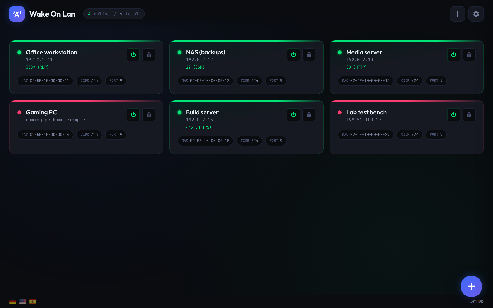

## Light theme

Settings › Theme switches between Dark (the default), Light, and Auto, which
follows the system.

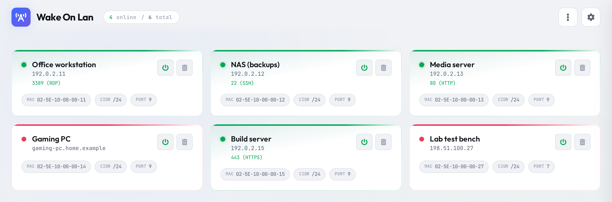

## Compact view

Settings › Compact view shows one host per row.

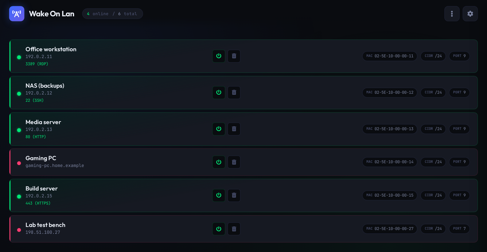

## Phone

Below 768 px the grid becomes one column, and the counter moves under the title.

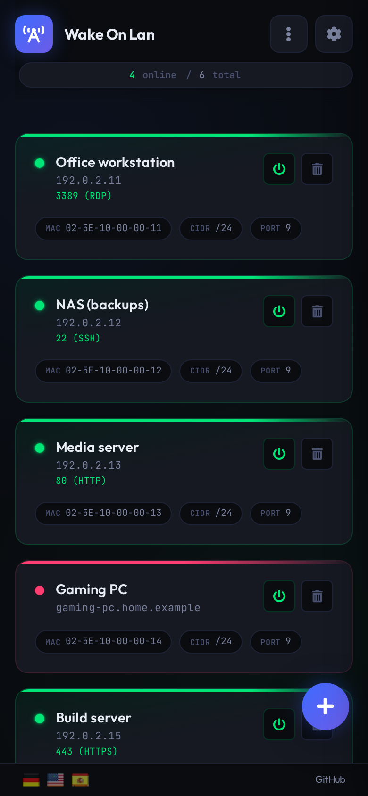

## No hosts

The page with no hosts saved yet.

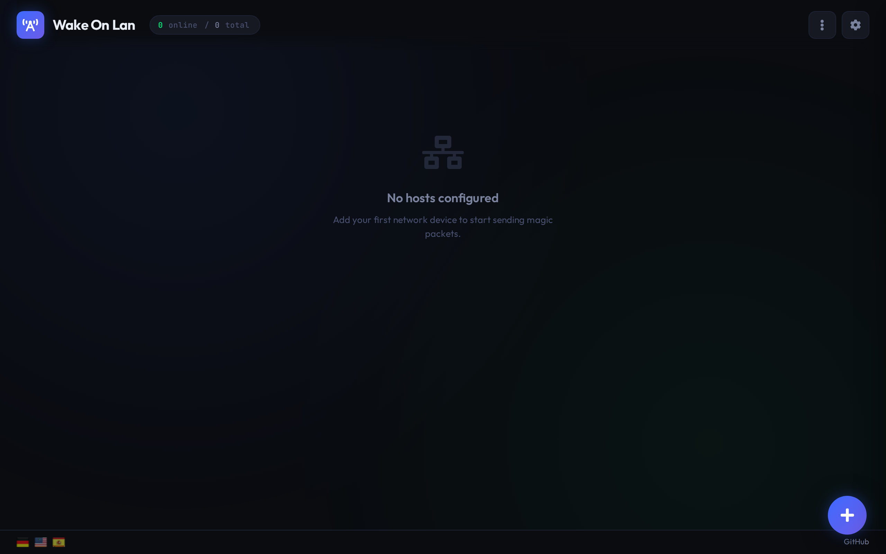

## Waking a host

The power button sends the magic packet. A toast confirms that it was sent.
That only means the packet left the server, not that the host woke up. Watch
its dot turn green.

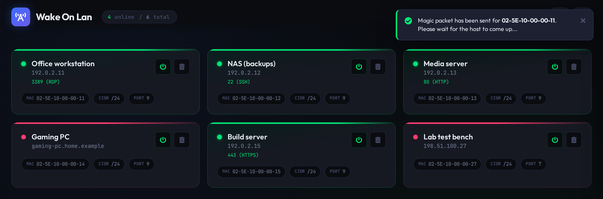

## Adding a host

The **+** button opens the Add Host dialog. CIDR and port are pre-filled with
the defaults from Settings. A MAC address may use `-`, `:` or no separators.

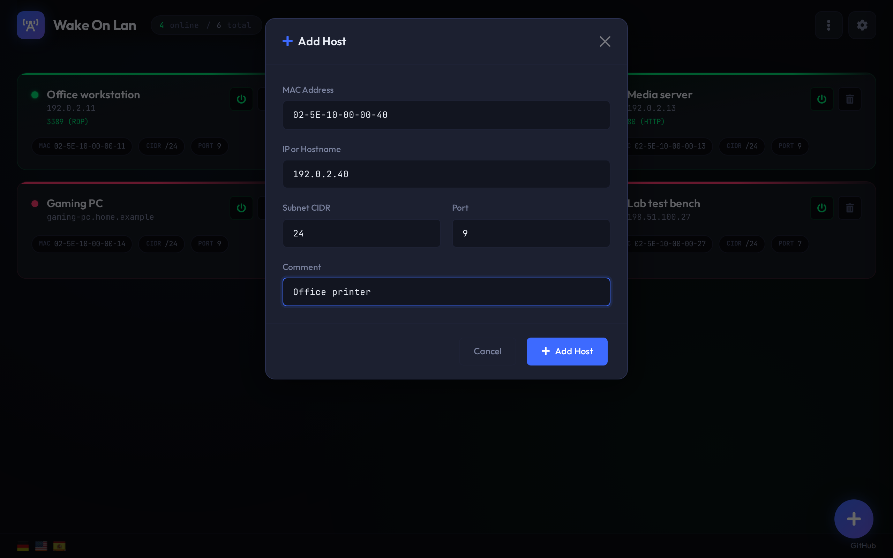

## Invalid input

Add Host checks the form and lists every problem in a warning toast.

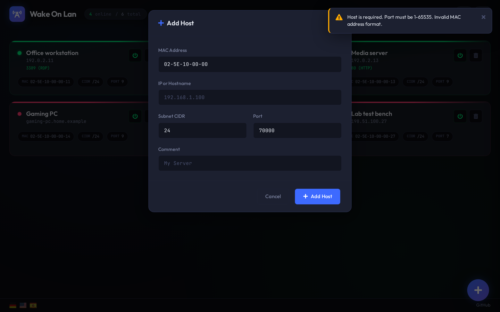

## Unsaved changes

Adding, removing or reordering cards changes only the page. The save bar at
the bottom stays until you **Save** to the server or **Cancel**, which reloads
the saved configuration.

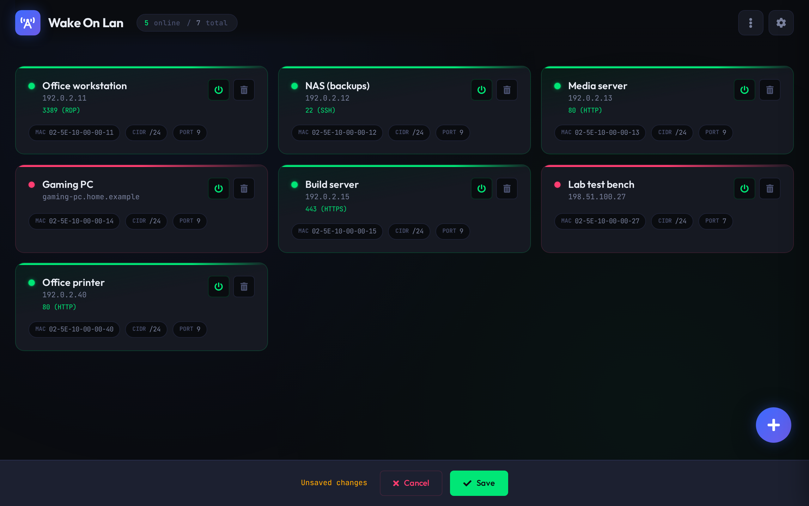

## Settings

The gear opens the settings panel. Settings are stored per browser in
`localStorage`. This shows the defaults.

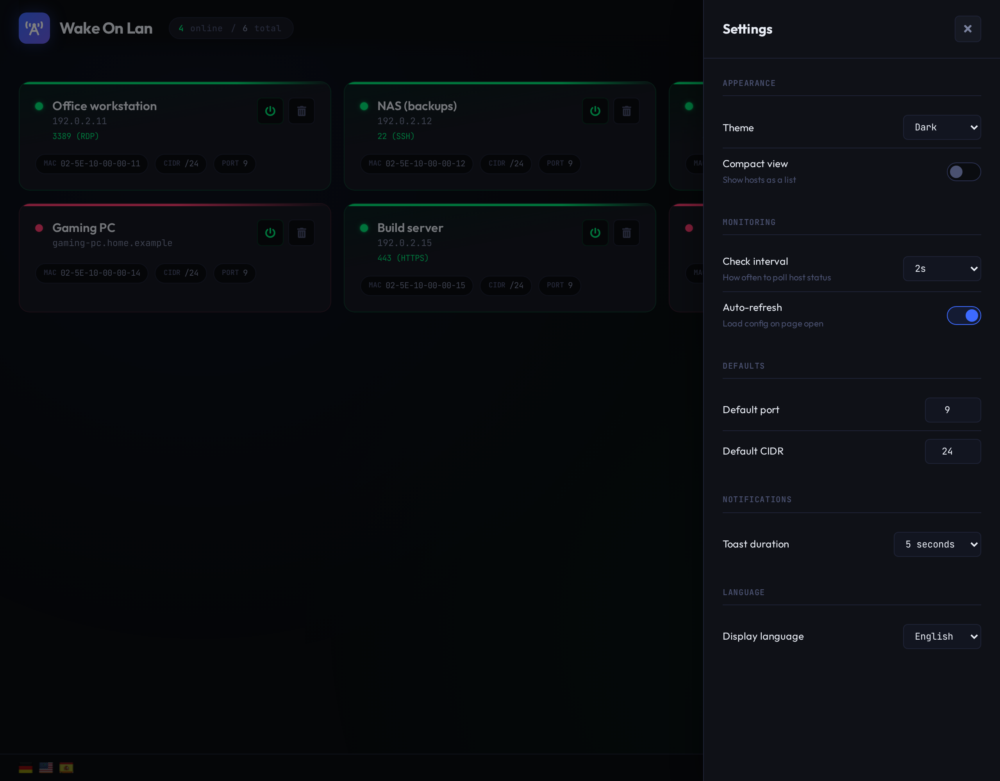

## Options menu

The menu next to the gear. **Save Configuration** appears there too while
there are unsaved changes.

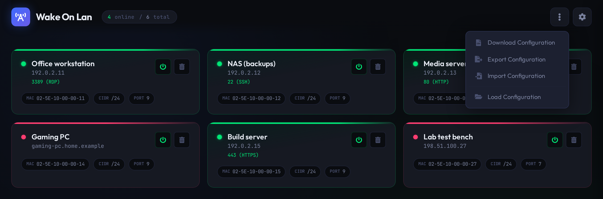

## Export configuration

The configuration on the page as JSON, to copy.

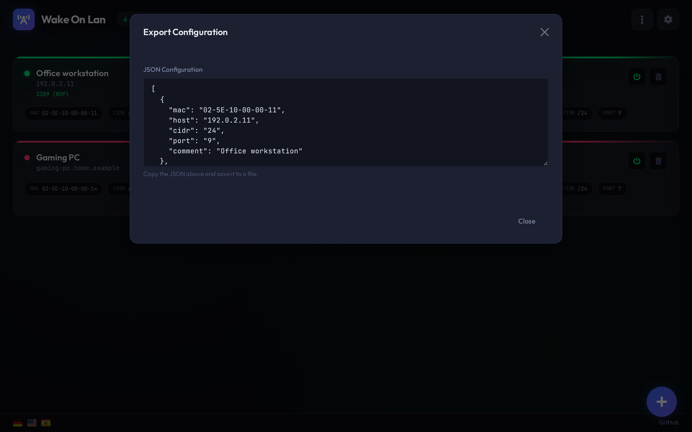

## Import configuration

Paste JSON to append hosts, or tick **Overwrite existing configuration** to
replace them. Imported hosts count as unsaved changes.

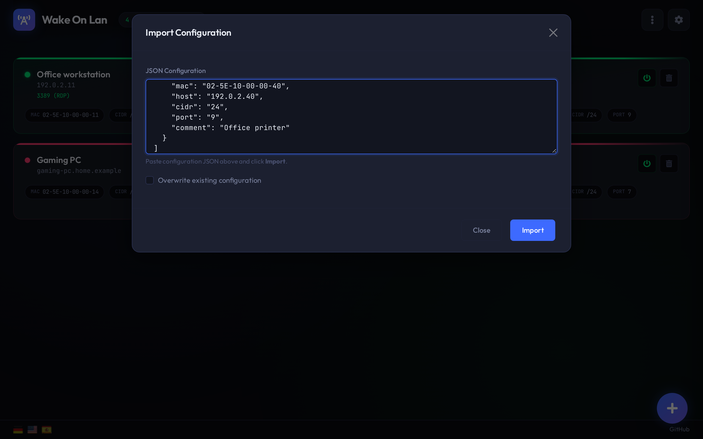

## Import error

JSON that does not parse is rejected inside the dialog.

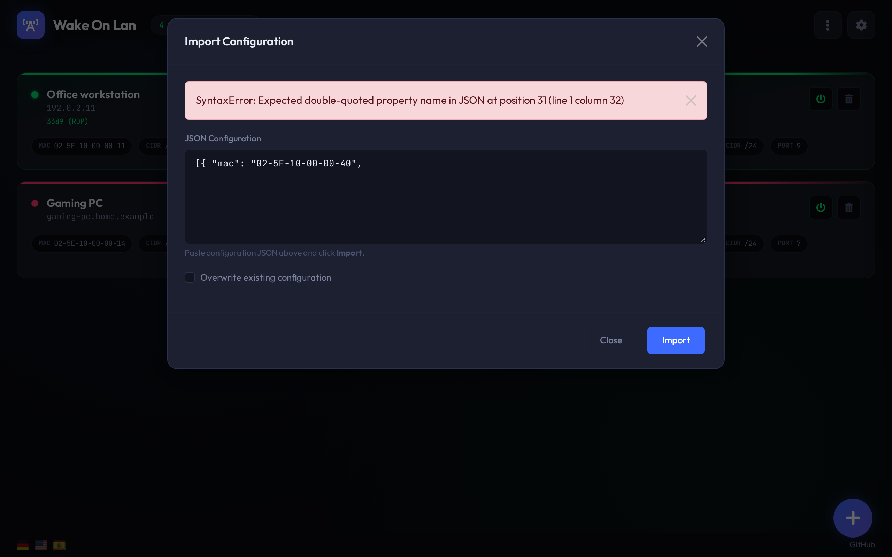

## Load configuration

Reloads the configuration from the server. Choose whether it replaces the
hosts on the page or is appended to them.

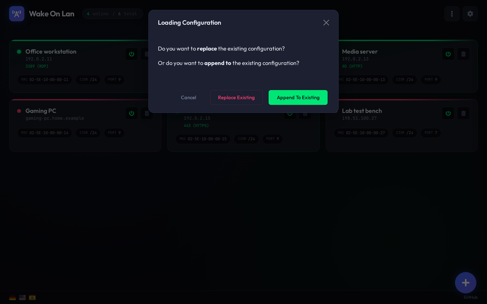
